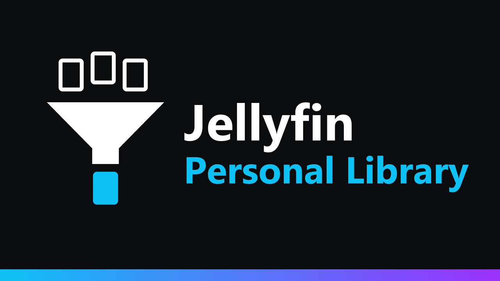

<p align="center">
  
</p>

<p align="center">
  <a href="https://github.com/k1k4k/jellyfin-personal-library/releases/latest"></a>
  
  <a href="https://github.com/k1k4k/jellyfin-personal-library/releases"></a>
  <a href="LICENSE"></a>
</p>

<p align="center">
  <b>Une bibliothèque partagée, une vue personnelle pour chaque utilisateur.</b><br>
  Chacun choisit ce qu'il voit, et l'aléatoire ne pioche que là-dedans.
</p>

<p align="center">
  <a href="#installation">Installation</a> ·
  <a href="#fonctionnalités">Fonctionnalités</a> ·
  <a href="#comment-ça-marche">Comment ça marche</a> ·
  <a href="#dépannage">Dépannage</a> ·
  <a href="README.md">English version</a>
</p>

Quand plusieurs personnes partagent le même dossier de musique, « Tout en aléatoire » joue la musique de tout le monde. Séparer le dossier en plusieurs bibliothèques n'est pas toujours possible, et les restrictions par étiquettes de Jellyfin sont réservées à l'administrateur et se posent élément par élément.

Avec ce plugin, chaque utilisateur décide lui-même : « uniquement mes artistes et ces trois albums » pour la musique, tout pour les films, tout sauf deux séries. Le reste du serveur lui est caché, partout, dans toutes les applications.

## Fonctionnalités

### Un mode par type de contenu

Pour la musique, les films, les séries, les collections… (un seul réglage pour toutes les bibliothèques de ce type) :

| Mode | Ce que voit l'utilisateur |
|---|---|
| **Tout** | toute la bibliothèque (par défaut) |
| **Tout sauf…** | tout, sauf ce qu'il masque |
| **Uniquement…** | seulement ce qu'il garde ; rien de choisi = rien d'affiché |

On choisit des artistes, des albums, des dossiers, des films, des séries ou des collections. Les nouveautés couvertes suivent toutes seules : un nouvel album d'un artiste ou d'un dossier gardé apparaît après le scan suivant.

### Fenêtre « Ma bibliothèque »

- Un **bouton en haut** (à côté de Rechercher) l'ouvre.
- Un onglet par type de contenu, les trois modes, les choix en cours.
- **Recherche et parcours de toute la bibliothèque**, contenu masqué compris : ce qu'on a masqué, ou dont quelqu'un nous a parlé, se retrouve et se rajoute.
- Changer de mode demande confirmation, car les choix n'ont pas le même sens en « Tout sauf » et en « Uniquement ».

### Depuis le menu ⋮

- **Masquer de ma bibliothèque** sur n'importe quel élément.
- **Retirer de ma bibliothèque** sur ce qu'on a gardé en mode « Uniquement… ».

### Pour l'administrateur

**Tableau de bord → Plugins → Jellyfin Personal Library** :

- qui l'utilise, avec ses modes ;
- réinitialiser un utilisateur, ou tout le monde ;
- couper le libre-service (un administrateur peut toujours régler la bibliothèque d'un utilisateur par l'API).

Désinstaller le plugin depuis le tableau de bord retire toutes ses étiquettes : tout le monde voit de nouveau tout.

## Comment ça marche

Jellyfin sait déjà cacher des éléments à un utilisateur : **Tableau de bord → Utilisateurs → utilisateur → Contrôle parental → « Bloquer les éléments avec ces étiquettes » / « Autoriser uniquement les éléments avec ces étiquettes »**. Le plugin s'en occupe pour vous :

- il pose une étiquette technique (`pl-…-hide` ou `pl-…-show`, une paire par utilisateur) sur les éléments concernés, et l'ajoute au profil de l'utilisateur ;
- le serveur les retire alors de toutes les requêtes : navigation, recherche, aléatoire, mix instantané, nouveautés, genres, artistes. Toutes les applications en profitent, pas seulement l'interface web ;
- après chaque scan, et quand les métadonnées d'un élément sont remplacées, les étiquettes sont recalculées.

Bon à savoir :

- Les étiquettes techniques apparaissent dans l'éditeur de métadonnées et dans le filtre « Étiquettes ». Ne les retirez pas à la main : passez par la fenêtre ou les boutons de réinitialisation.
- En mode « Uniquement… », Jellyfin cache sur tout le serveur ce qui ne porte pas l'étiquette « show » de l'utilisateur. Le plugin étiquette donc aussi les autres types de contenu laissés sur « Tout », les genres, les playlists de l'utilisateur et les collections qui contiennent quelque chose de visible. Sur Jellyfin 12, une seule étiquette par bibliothèque suffit ; sur 10.11, chaque élément est étiqueté, ce qui prend plus de temps la première fois sur une grosse bibliothèque.
- Les étiquettes sont enregistrées sans passer par les enregistreurs de métadonnées : aucun fichier `.nfo` n'est réécrit.
- Si un utilisateur est déjà restreint par « Autoriser uniquement les éléments avec ces étiquettes », le mode « Uniquement… » ne lui est pas proposé : il élargirait cette restriction.
- Un élément masqué ainsi n'est plus listé, cherchable ni ouvrable, mais quelqu'un qui connaît son identifiant exact peut encore le lire (comme avec les restrictions par étiquettes de Jellyfin). C'est une vue personnelle, pas une séparation de sécurité entre utilisateurs.

## Installation

### Plugin (recommandé)

1. **Tableau de bord → Plugins → Gérer les dépôts → `+`**, puis l'adresse du dépôt de plugins k1k4k qui correspond à votre Jellyfin :

   | Jellyfin | Adresse du dépôt |
   |---|---|
   | 12.x | `https://k1k4k.github.io/jellyfin-plugins/manifest.json` |
   | 10.11.x | `https://k1k4k.github.io/jellyfin-plugins/manifest-10.11.json` |

   Ce dépôt liste tous les plugins k1k4k (Background Play, Player Queue, True Music Library, Pro Downloader…). Si vous l'avez déjà ajouté, ou celui de Player Queue, il n'y a rien à faire.

2. **Plugins → Disponibles → Jellyfin Personal Library → Installer**, puis redémarrez Jellyfin.
3. Rechargez la page web (`Ctrl+F5`).

Les nouvelles versions apparaissent dans le tableau de bord.

<details>
<summary><b>Autres méthodes (sans le dépôt)</b></summary>

#### Plugin, à la main

Téléchargez le zip de la [dernière release](https://github.com/k1k4k/jellyfin-personal-library/releases/latest) (`_jf12` pour Jellyfin 12, `_jf10` pour 10.11), décompressez-le dans `<config>/plugins/Jellyfin Personal Library/` et redémarrez Jellyfin.

#### Script d'installation

Copie le plugin dans le dossier `plugins` de Jellyfin (dernière release, un zip de release, ou compilé depuis ces sources) et choisit la bonne variante selon la version du serveur.

```powershell
# Windows
.\install.ps1                                                                    # Jellyfin local
.\install.ps1 -PluginsDir "\\SERVEUR\plugins" -ServerUrl "http://SERVEUR:8096"   # partage réseau
.\install.ps1 -Build                                                             # depuis les sources (SDK .NET 10, ou 9 pour 10.11)
.\install.ps1 -Uninstall
```

```bash
# Linux (plugins dans /var/lib/jellyfin/plugins)
sudo ./install.sh --restart
sudo ./install.sh --uninstall
```

Puis redémarrez Jellyfin. Désinstaller avec un script ne retire pas les étiquettes : cliquez d'abord sur **Tout réinitialiser** dans la page du plugin.

</details>

## Compatibilité

| | |
|---|---|
| **Jellyfin 12.x** | testé (12.1.0) |
| **Jellyfin 10.11** | serveur testé (10.11.11) ; le code du client web utilisé est le même qu'en 12.x |
| **Interface web** (mise en page classique et nouvelle) | oui |
| **Autres applications** (applis mobiles, Finamp, Jellyfin Media Player, applis TV…) | le contenu masqué y est masqué aussi ; la fenêtre « Ma bibliothèque » et les entrées de menu n'existent que dans l'interface web |
| **Derrière un proxy inverse, NAS, Docker** | oui |

## Dépannage

- **Pas de bouton en haut** : rechargez la page avec `Ctrl+F5`, puis regardez la console du navigateur (F12) : `[PersonalLibrary] v… – ready`. Le bouton est caché si l'administrateur a coupé le libre-service et que l'utilisateur n'a aucun choix.
- **Une liste affiche encore ce que je viens de masquer** : Jellyfin garde les pages déjà affichées ; changez de page ou rechargez.
- **« Uniquement… » est grisé** : votre profil est déjà restreint par l'administrateur avec « Autoriser uniquement les éléments avec ces étiquettes ».
- **Tout a disparu pour un utilisateur** : un type de contenu est en « Uniquement… » sans rien de choisi. Choisissez quelque chose, ou repassez en « Tout ».
- **Le premier changement prend du temps sur une grosse bibliothèque (Jellyfin 10.11)** : chaque élément des autres types de contenu reçoit une étiquette la première fois ; les changements suivants sont rapides.

<details>
<summary><b>Développement</b></summary>

#### Plugin

`Jellyfin.Plugin.PersonalLibrary/` : une seule source, deux cibles, `-p:JellyfinTarget=jf12` (Jellyfin 12, .NET 10, par défaut) et `jf10` (Jellyfin 10.11, .NET 9). Le script client `jellyfin-personal-library.js` est embarqué dans la DLL et injecté dans `index.html` au moment de la requête (rien n'est écrit dans le dossier web). Sans SDK local :

```bash
docker run --rm -v "$PWD:/src" -w /src mcr.microsoft.com/dotnet/sdk:10.0 dotnet build Jellyfin.Plugin.PersonalLibrary/Jellyfin.Plugin.PersonalLibrary.csproj -c Release -o out/jf12
```

Les choix sont enregistrés dans `<config>/plugins/configurations/PersonalLibrary/`.

#### API

| | |
|---|---|
| `GET /PersonalLibrary/Me` | types de contenu, leurs bibliothèques, mode et choix de l'utilisateur connecté |
| `PUT /PersonalLibrary/Me/Types/{type}` | change le mode (`{ "Mode": "All" \| "Except" \| "Only" }`) |
| `POST /PersonalLibrary/Me/Types/{type}/Rules` | ajoute un choix (`{ "ItemId": "…" }`) |
| `DELETE /PersonalLibrary/Me/Types/{type}/Rules/{itemId}` | retire un choix |
| `GET /PersonalLibrary/Me/Browse` | contenu d'une bibliothèque sans tenir compte des choix de l'utilisateur (`libraryId`, `parentId`, `searchTerm`…) |
| `POST /PersonalLibrary/Me/Apply` | applique tout de suite |
| `DELETE /PersonalLibrary/Me` | réinitialise l'utilisateur |

Un administrateur peut viser un autre utilisateur avec `?userId=`. `GET /PersonalLibrary/Users` et `DELETE /PersonalLibrary/Users` (tout réinitialiser) sont réservés aux administrateurs.

#### Publier une version

1. Augmentez `<Version>` / `<AssemblyVersion>` dans le csproj ; ajoutez une section `## X.Y.Z` à `CHANGELOG.md`.
2. `git tag vX.Y.Z && git push origin vX.Y.Z` : le workflow **Release** compile les deux cibles, publie la release et met à jour les manifestes sur `main`. Le dépôt central [`jellyfin-plugins`](https://github.com/k1k4k/jellyfin-plugins) les reprend à son prochain passage (toutes les heures, ou tout de suite avec le secret `PLUGINS_REPO_TOKEN`).

</details>

## Licence

MIT, voir [LICENSE](LICENSE).
