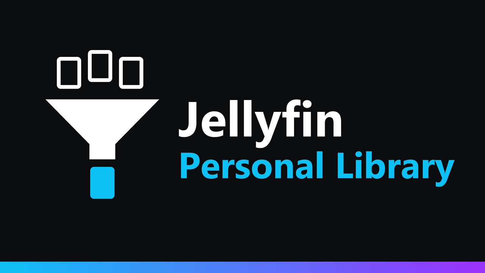

<p align="center">
  
</p>

<p align="center">
  <a href="https://github.com/k1k4k/jellyfin-personal-library/releases/latest"></a>
  
  <a href="https://github.com/k1k4k/jellyfin-personal-library/releases"></a>
  <a href="LICENSE"></a>
</p>

<p align="center">
  <b>One shared library, a personal view for each user.</b><br>
  Everyone picks what they see, and shuffle only plays from that.
</p>

<p align="center">
  <a href="#installation">Installation</a> ·
  <a href="#features">Features</a> ·
  <a href="#how-it-works">How it works</a> ·
  <a href="#troubleshooting">Troubleshooting</a> ·
  <a href="README.fr.md">Version française</a>
</p>

When several people share one music folder, "shuffle all" plays everybody's music. Splitting the folder into separate libraries isn't always possible, and Jellyfin's tag restrictions are admin-only and have to be set item by item.

With this plugin, each user decides for themselves: "only my artists and these three albums" for music, everything for movies, everything except two shows. The rest of the server is hidden for them, everywhere, in every app.

## Features

### A mode per content type

For music, movies, shows, collections… (one setting covers every library of that type):

| Mode | What the user sees |
|---|---|
| **Everything** | the whole library (default) |
| **All except…** | everything except what they hide |
| **Only…** | only what they keep; nothing chosen means nothing shown |

Choices are artists, albums, folders, movies, shows or collections. New content they cover follows automatically: a new album of a kept artist or folder appears after the next scan.

### "My library" window

- A **button at the top** (next to Search) opens it.
- A tab per content type, the three modes, the current choices.
- **Search and browse the whole library**, hidden content included: something you hid, or that someone told you about, can be found and brought back.
- Changing mode asks first, because choices don't mean the same thing in "All except" and "Only".

### From the ⋮ menu

- **Hide from my library** on any item.
- **Remove from my library** on something you kept in "Only…" mode.

### For the administrator

**Dashboard → Plugins → Jellyfin Personal Library**:

- who uses it, with their modes;
- reset one user, or everyone;
- turn self-service off (an administrator can still set a user's library through the API).

Uninstalling the plugin from the dashboard removes all its tags, so everyone sees everything again.

## How it works

Jellyfin can already hide items from a user: **Dashboard → Users → user → Parental control → "Block items with tags" / "Allow items with tags"**. The plugin drives that for you:

- it puts a technical tag (`pl-…-hide` or `pl-…-show`, one pair per user) on the items concerned, and adds it to the user's profile;
- the server then filters them out of every query: browsing, search, shuffle, instant mix, latest, genres, artists. Any app benefits, not only the web interface;
- after each scan, and when an item's metadata is replaced, the tags are recalculated.

Good to know:

- The technical tags show up in the metadata editor and in the "Tags" filter. Don't remove them by hand; use the window or the reset buttons.
- In "Only…" mode, Jellyfin hides everything that doesn't carry the user's "show" tag, on the whole server. The plugin therefore also tags the other content types left on "Everything", the genres, the user's playlists and the collections that contain something visible. On Jellyfin 12, a tag on each library and on its root folders is enough; on 10.11 every item is tagged, which takes longer the first time on a big library.
- Tags are saved without running metadata savers: no `.nfo` file is rewritten.
- If a user is already restricted by "Allow items with tags", "Only…" isn't offered to them: it would widen the restriction.
- An item hidden this way can't be listed, searched or opened, but someone who knows its exact ID can still stream it (same as Jellyfin's own tag restrictions). This is a personal view, not a security boundary between users.

## Installation

### Plugin (recommended)

1. **Dashboard → Plugins → Manage Repositories → `+`**, then the k1k4k plugin repository URL matching your Jellyfin:

   | Jellyfin | Repository URL |
   |---|---|
   | 12.x | `https://k1k4k.github.io/jellyfin-plugins/manifest.json` |
   | 10.11.x | `https://k1k4k.github.io/jellyfin-plugins/manifest-10.11.json` |

   This repository lists every k1k4k plugin (Background Play, Player Queue, True Music Library, Pro Downloader…). If you already added it, or the Player Queue repository, there's nothing to do.

2. **Plugins → Available → Jellyfin Personal Library → Install**, then restart Jellyfin.
3. Reload the web page (`Ctrl+F5`).

New versions show up in the dashboard.

<details>
<summary><b>Other methods (without the repository)</b></summary>

#### Plugin, by hand

Download the zip from the [latest release](https://github.com/k1k4k/jellyfin-personal-library/releases/latest) (`_jf12` for Jellyfin 12, `_jf10` for 10.11), unzip it into `<config>/plugins/Jellyfin Personal Library/` and restart Jellyfin.

#### Install script

Copies the plugin into Jellyfin's `plugins` folder (latest release, a release zip, or built from these sources) and picks the right build for your server version.

```powershell
# Windows
.\install.ps1                                                                  # local Jellyfin
.\install.ps1 -PluginsDir "\\SERVER\plugins" -ServerUrl "http://SERVER:8096"   # network share
.\install.ps1 -Build                                                           # from the sources (.NET SDK 10, or 9 for 10.11)
.\install.ps1 -Uninstall
```

```bash
# Linux (plugins in /var/lib/jellyfin/plugins)
sudo ./install.sh --restart
sudo ./install.sh --uninstall
```

Then restart Jellyfin. Uninstalling with a script doesn't remove the tags: click **Reset everyone** in the plugin page first.

</details>

## Compatibility

| | |
|---|---|
| **Jellyfin 12.x** | tested (12.1.0) |
| **Jellyfin 10.11** | server tested (10.11.11); the web client code it hooks into is the same as in 12.x |
| **Web interface** (classic and new layout) | yes |
| **Other apps** (mobile apps, Finamp, Jellyfin Media Player, TV apps…) | hidden content is hidden there too; the "My library" window and menu entries are only in the web interface |
| **Behind a reverse proxy, NAS, Docker** | yes |

## Troubleshooting

- **No button at the top**: reload the web page with `Ctrl+F5`, then check the browser console (F12): `[PersonalLibrary] v… – ready`. The button is hidden when the administrator turned self-service off and the user has no choices.
- **A list still shows something I just hid**: Jellyfin keeps pages already displayed; change page or reload.
- **"Only…" is greyed out**: your profile is already restricted by the administrator with "Allow items with tags".
- **Everything disappeared for a user**: a content type is on "Only…" with nothing chosen. Pick something, or switch back to "Everything".
- **The first change takes a while on a big library (Jellyfin 10.11)**: every item of the other content types gets a tag the first time; later changes are quick.

<details>
<summary><b>Development</b></summary>

#### Plugin

`Jellyfin.Plugin.PersonalLibrary/`: one source, two targets, `-p:JellyfinTarget=jf12` (Jellyfin 12, .NET 10, default) and `jf10` (Jellyfin 10.11, .NET 9). The client script `jellyfin-personal-library.js` is embedded in the DLL and injected into `index.html` at request time (nothing is written to the web folder). Without a local SDK:

```bash
docker run --rm -v "$PWD:/src" -w /src mcr.microsoft.com/dotnet/sdk:10.0 dotnet build Jellyfin.Plugin.PersonalLibrary/Jellyfin.Plugin.PersonalLibrary.csproj -c Release -o out/jf12
```

Choices are stored in `<config>/plugins/configurations/PersonalLibrary/`.

#### API

| | |
|---|---|
| `GET /PersonalLibrary/Me` | content types, their libraries, mode and choices of the signed-in user |
| `PUT /PersonalLibrary/Me/Types/{type}` | sets the mode (`{ "Mode": "All" \| "Except" \| "Only" }`) |
| `POST /PersonalLibrary/Me/Types/{type}/Rules` | adds a choice (`{ "ItemId": "…" }`) |
| `DELETE /PersonalLibrary/Me/Types/{type}/Rules/{itemId}` | removes a choice |
| `GET /PersonalLibrary/Me/Browse` | a library's content regardless of the user's own choices (`libraryId`, `parentId`, `searchTerm`…) |
| `POST /PersonalLibrary/Me/Apply` | applies now |
| `DELETE /PersonalLibrary/Me` | resets the user |

An administrator can target another user with `?userId=`. `GET /PersonalLibrary/Users` and `DELETE /PersonalLibrary/Users` (reset everyone) are admin-only.

#### Releasing

1. Bump `<Version>` / `<AssemblyVersion>` in the csproj; add a `## X.Y.Z` section to `CHANGELOG.md`.
2. `git tag vX.Y.Z && git push origin vX.Y.Z`: the **Release** workflow builds both targets, publishes the release and updates the manifests on `main`. The central [`jellyfin-plugins`](https://github.com/k1k4k/jellyfin-plugins) repository picks them up on its next run (hourly, or right away with the `PLUGINS_REPO_TOKEN` secret).

</details>

## License

MIT, see [LICENSE](LICENSE).
